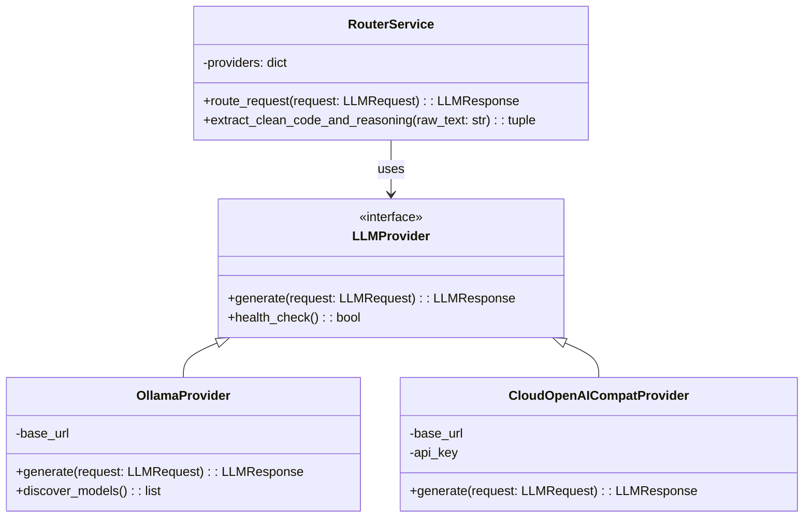

# Architecture Decision Record: Strategy + Factory + Decorator

## Context
We need to implement a dynamic LLM routing system that can handle multiple providers (Local Ollama, Free Cloud APIs like Gemini/OpenRouter, and Commercial APIs). The system must support automatic retries, exponential backoff, telemetry gathering, and robust parsing of outputs (especially from reasoning models).

## Decision
We will employ a combination of the **Strategy**, **Factory**, and **Decorator** design patterns instead of simple `if/else` branching within a monolithic function.

### 1. Strategy Pattern for Providers
We define an abstract base class `LLMProvider` (the Strategy interface). Each specific backend (e.g., `OllamaProvider`, `CloudOpenAICompatProvider`) implements this interface.
*   **Why:** This adheres to the Open-Closed Principle. If we want to add an Anthropic provider later, we simply create a new class implementing `LLMProvider` without modifying the core routing logic. `if/else` branching would require modifying the router every time a new provider is added.

### 2. Factory Pattern for Instantiation
The `RouterService` will act as a factory, maintaining a registry of available providers. Based on incoming requests or configuration, it will instantiate and return the correct provider instance.
*   **Why:** Encapsulates the complex logic of configuring and initializing different providers (e.g., setting up base URLs, injecting API keys).

### 3. Decorator Pattern for Resilience & Telemetry
We will use Python decorators (or wrapper functions in the router) to handle cross-cutting concerns like retries, backoff, and logging.
*   **Why:** Separates the core business logic (sending a request) from infrastructural concerns (handling an HTTP 429 error).

## Architecture Diagram (Mermaid)

## Consequences
*   **Positive:** Highly decoupled architecture. Easy to test individual providers in isolation using mocks. New providers can be added seamlessly.
*   **Negative:** Slight increase in initial complexity and boilerplate compared to a quick `if/else` script. Requires careful definition of the `LLMRequest` and `LLMResponse` contracts to ensure all providers can fulfill them.
