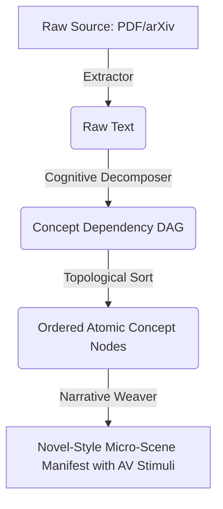

# Ingestion Architecture ADR

## Decision
We abstract all input modalities (arXiv, PDF, Markdown, Topic string) into a unified `IngestionSource` contract.

## Pipeline Diagram (Mermaid representation)

The architecture enforces Working Memory Anchor injections during the graph traversal to maintain low cognitive load.
